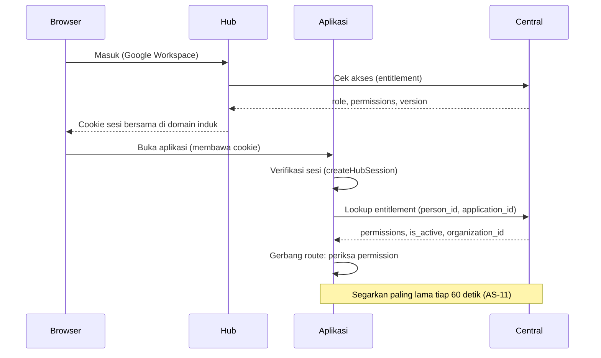

# Panduan menyambungkan aplikasi ke SSO dan Application Access

Untuk developer yang menyambungkan aplikasi baru atau lama ke Hub dan Central. Aturan yang dipatuhi ada di [access-standard.md](access-standard.md); di sini hanya urutan kerja dan contoh. Detail API (lookup, token, scope) ada di [application-access-integration.md](application-access-integration.md). Status aplikasi lain ada di [access-conformance.md](access-conformance.md).

## Gambaran alur



Aplikasi tidak pernah menentukan siapa boleh masuk atau melakukan apa dengan datanya sendiri. Ia menerima daftar permission dari Central dan menegakkannya.

## Urutan kerja

1. **Daftarkan aplikasi di Central** (Super Admin): Application Access, Add application. Catat Application ID dan Organization ID. Beri aplikasi API client dengan scope `application_entitlements:read` dan `application_permissions:write`. Langkah rinci: bagian "Cara menambah aplikasi baru" di `application-access-integration.md`.
2. **Tulis manifest permission di kode** (AS-3, AS-4) dengan `definePermissions` dari `mws-central-auth/access`. Satu konstanta, dipakai ulang oleh route dan menu, dan diperiksa saat dimuat:
   ```ts
   export const PERMISSIONS = [
     { key: 'inventory.use', description: 'Sign in to the app' },
     { key: 'inventory.read', description: 'Open the inventory list', requires: ['inventory.use'] },
     { key: 'inventory.manage', description: 'Add, edit and delete items', requires: ['inventory.read'] },
   ] as const;
   ```
3. **Sinkronkan saat deploy**: skrip tiga baris yang memanggil `runPermissionsCli` (`mws-central-auth/access/cli`) memberi `permissions:sync` (gagal keras) dan `permissions:check` di CI. Jangan di dalam boot aplikasi.
4. **Buat role di Central** (AS-5): lewat UI, atau tulis `role-presets.json` di repo aplikasi lalu jalankan `bun run seed:application-roles role-presets.json --as <email super admin>` dari repo Central.
5. **Buat group akses** di Central: siapa mendapat role apa (audience, unit, posisi, level). Exception untuk perkecualian.
6. **Verifikasi sesi**: baca cookie Hub dengan `createHubSession` dari `mws-central-auth` (`hub.fromCookieHeader(...)`). Hasilnya klaim `{ sub, email, source, tags, sid }`; `sub` adalah `person_id`. Lalu `hub.step(...)` menjawab `ok`, `restore` (arahkan ke `hub.restoreUrl`), atau `hub` (arahkan ke `hub.homeUrl`). Di browser, `keepFresh` menjaga token tetap segar.
7. **Ambil entitlement** (AS-10) dengan `createAccessResolver` (`mws-central-auth/access`), bukan kode sendiri: `lookupApplicationEntitlement({ person_id, application_id })`. 404 berarti ditolak. Periksa `is_active`, `organization_id`, dan bahwa semua permission ada di manifest.
8. **Bentuk pengguna sesi** dari entitlement dan pasang di request: `{ id, permissions, ... }`. Tidak ada `role` yang dipakai untuk keputusan.
9. **Gerbang route** (AS-6). Contoh Fastify:
   ```ts
   app.get('/items', { preHandler: requirePermission('inventory.read') }, listItems);
   app.post('/items', { preHandler: requirePermission('inventory.manage') }, createItem);
   ```
   `requirePermission` membaca `request.currentUser.permissions` dan menjawab 403 bila tidak ada. Untuk route yang dipakai beberapa jenis pelaku, pakai varian "salah satu dari". Referensi: Woko `apps/api/src/auth.ts`, Hub `backend/src/lib/hub-access-gate.ts`.
10. **Menu dan tombol** (AS-7): `can(user.permissions, 'inventory.manage')` dengan konstanta yang sama.
11. **Scope data** (AS-8): permission `scope.*` menentukan filter kueri; baris yang terjangkau tetap di database aplikasi. Tanpa permission scope, default sempit.
12. **Segarkan dan cabut** (AS-11): simpan cache entitlement paling lama 60 detik; jika `is_active` false atau 404, putus akses pada penyegaran berikutnya.
13. **Tes kesesuaian** (AS-15): tulis `access.config.json` dan jalankan `mws-access check` di CI (manifest, preset, probe gerbang route, typo key, nama role), lalu perbarui [access-conformance.md](access-conformance.md). Contoh lengkap ada di README `mws-central-auth`.

## Mode uji lokal (AS-12)

Aplikasi boleh punya mode login uji untuk pengembangan lokal (contoh Woko `AUTH_MODE=test`), dengan syarat ditolak saat `NODE_ENV=production`, dan pengguna ujinya membawa daftar permission dari fixture. Jangan menambah tabel role untuk ini.

## Dokumen di repo publik

Semua repo MWS publik. Contoh alamat, nama stack, jaringan gateway, host Komodo, dan URL webhook di dokumen harus berupa placeholder (`hub.example.org`, `central.example.org`, `<staging-stack>`, `<gateway-network-production>`, `<komodo-host>`). Nilai sebenarnya hanya ada di Komodo dan di GitHub Environments.

## Kalau tidak bisa masuk

Jalankan `mws-access doctor` (dari kit `mws-central-auth` 0.14, memakai `access.config.json` yang sama dengan `mws-access check`), dengan `--url` alamat API aplikasi yang sedang berjalan. Ia memeriksa baris `.env`, Hub, token Central beserta profile-nya, daftar permission, siapa yang punya akses, dan apakah aplikasi yang berjalan benar-benar menolak pengunjung tanpa cookie. Setiap kegagalan mencetak baris `Fix:`. Blok `.env` dari Central (saat aplikasi ditambah atau token diputar) sudah memuat `APP_BASE_URL` dari alamat masuk aplikasi. Setelah mengubah `.env`, aplikasi harus di-restart.

## Kesalahan yang sering terjadi

- Memeriksa `role === 'ADMIN'` karena "cuma satu tempat". Selalu tambahkan permission-nya di manifest.
- Menambah permission di role Central sebelum aplikasi men-deploy manifest baru. Urutannya: kode, deploy, sinkron, baru role.
- Mengganti nama permission langsung. Pakai alur AS-14.
- Menyembunyikan tombol tetapi lupa gerbang route.
- Membandingkan `version` antar `id` berbeda.
- Meng-cache 404 terlalu lama sehingga orang yang baru diberi akses tetap ditolak.
- Membuat admin pertama dari "pengguna pertama yang login". Tentukan di Central.

## Aplikasi lama yang sudah punya role lokal

1. Tulis manifest dari hak yang sekarang ditentukan role (ubah tiap pemeriksaan role menjadi permission).
2. Tulis `role-presets.json` dari kumpulan permission tiap role lama, sehingga perilaku tidak berubah saat pindah.
3. Backfill pengguna: buat group atau entitlement di Central yang setara dengan role lama.
4. Pindahkan sumber permission ke entitlement. Tabel lokal tinggal cache, lalu hapus layar pemberian akses dan tabel role di rilis berikutnya.
